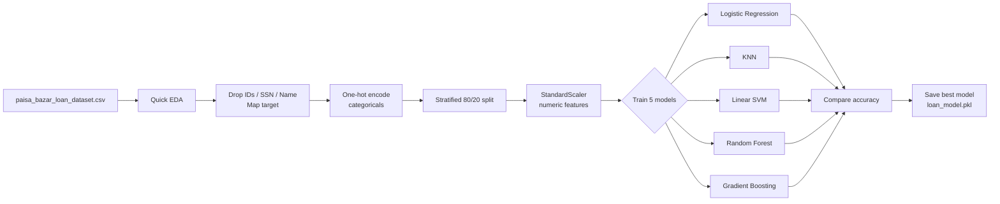

# PaisaBazar — Credit Score Classification


A machine learning pipeline that classifies customers' credit scores as **Good**, **Standard** or **Poor**. It trains five classifiers, compares them, and saves the most accurate one so it can be deployed.

---

## Problem Statement

Paisabazaar helps customers find and apply for banking and credit products. A key part of its service is assessing creditworthiness, and credit scores are crucial for loan approvals and risk management. Accurate credit score classification reduces default risk and enables personalised financial advice.

**Goal:** predict a customer's `Credit_Score` category from their financial and behavioural attributes.

## Dataset

The script expects a CSV named `paisa_bazar_loan_dataset.csv` (Labmentix internship dataset). **The dataset is not included in this repository.**

Columns the code uses:

| Role | Columns |
|---|---|
| Target | `Credit_Score` (`Good` → 2, `Standard` → 1, `Poor` → 0) |
| Dropped (identifiers / sensitive / high-cardinality) | `ID`, `Customer_ID`, `Month`, `Name`, `SSN`, `Type_of_Loan` |
| One-hot encoded categoricals | `Occupation`, `Credit_Mix`, `Payment_of_Min_Amount`, `Payment_Behaviour` |
| Features | All other remaining columns (numeric columns are standardised) |

## Approach

1. **Load and quick EDA:** head, tail, shape, dtypes, `describe()`, missing values per column, duplicate rows.
2. **Cleaning:** drop the identifier and sensitive columns, map the target to integers, drop rows with unknown targets or remaining missing values.
3. **Feature engineering:** one-hot encode the categorical columns (`drop_first=True`).
4. **Split:** 80/20 train/test, stratified on the target (falls back to an unstratified split if stratification fails), `random_state=42`.
5. **Scaling:** `StandardScaler` on numeric features, used for the linear and distance-based models.
6. **Model comparison:** five classifiers, each evaluated on accuracy and a full classification report:
   - Logistic Regression (`max_iter=1000`)
   - K-Nearest Neighbors
   - Support Vector Machine (`LinearSVC`, chosen for speed on large data)
   - Random Forest (`n_estimators=100`)
   - Gradient Boosting (`n_estimators=100`)
7. **Model selection:** the most accurate model is pickled together with its feature columns, plus the scaler if the winning model needs scaling.

## Workflow



## Tech Stack

- **Language:** Python
- **Libraries:** pandas, NumPy, scikit-learn, Matplotlib, Seaborn

## Project Structure

```
PaisaBazar/
├── PaisaBazar              # Python script (exported from the "Paisa Bazar.ipynb" notebook)
├── bar graph result.png    # Model accuracy comparison chart
└── README.md
```

## How to Run

```bash
git clone https://github.com/Gonugunta-Venkata-Jayanth/PaisaBazar.git
cd PaisaBazar
pip install pandas numpy scikit-learn matplotlib seaborn
```

1. Get `paisa_bazar_loan_dataset.csv` and put it somewhere on your machine.
2. Open the `PaisaBazar` script and change `csv_path` in `main()` (it currently points to a local Windows path) to your file's location.
3. Run it:

```bash
python PaisaBazar
```

**Outputs:** EDA and per-model reports in the console, an accuracy comparison chart, and these files: `loan_model.pkl`, `model_columns.pkl`, and `scaler.pkl` (only when the best model is a scaled one).

## Results

Model accuracy comparison produced by the script:


The chart ranks the models by test accuracy from highest to lowest: **Random Forest**, K-Nearest Neighbors, Gradient Boosting, Logistic Regression, Support Vector Machine. Random Forest is the model the pipeline selects and saves.

## Author

**Jayanth Gonugunta Venkata** · [GitHub](https://github.com/Gonugunta-Venkata-Jayanth)
